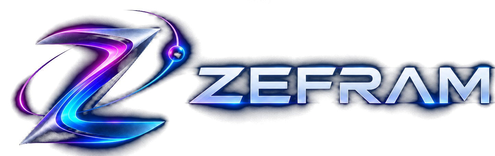

<p align="center">
  <a href="https://zefram.tech">
    
  </a>
</p>

# ZEFRAM

**FOR BUILDING SOFTWARE WITH AI**

A distro of LARAVEL, enhanced for the AI age. ZEFRAM is an **unofficial LARAVEL distribution** by Parallax Web Services, Inc.

Jump start your web development journey with a familiar foundation, editable modules, and a guided first application. Make web development fun & easy again.

[Website](https://zefram.tech) · [Getting started](https://zefram.tech/get-started) · [ARCHER](https://archer.zefram.tech) · [SLIPSTREAM](https://slipstream.codes)

## What’s included

The current MVP includes:

- **LARAVEL 13** with **INERTIA 3**, **REACT 19**, **TAILWIND 4**, and **VITE 8**.
- **Maiden Voyage**: a guided Notes application with editable code and a live preview. Name your app, connect its Save button, and display saved notes.
- **JS and PHP editions**: browser storage for the JS edition, or session-scoped database storage for the PHP edition.
- **A reusable Notes module**: its PHP source, routes, database files, and React screen live together in `modules/notes`, with its own `Notes\` namespace.
- **SLIPSTREAM CLI**: included by default through `parallax/cli`; use the project command to scaffold editable kits.
- **SLIPSTREAM kits**: copy the Notes feature into your own module, then edit the generated files.
- **Local documentation** for getting started, modules, and kits.
- **LARAVEL BOOST** for working with AI coding agents.

This is an application you can run and customize. The standalone browser preview lets you try Maiden Voyage without running PHP; generated kits currently run in the LARAVEL/INERTIA application.

## Get started

Choose the path that fits what you want to do. Both paths start by cloning this repository:

```sh
git clone https://github.com/Parallax-Web-Services/zefram.git my-app
cd my-app
```

### Try the browser preview

Use **NODE.JS 24** and **NPM**. PHP, COMPOSER, and a database server are not needed for this preview.

```sh
npm install
npm run build
npm run serve:js
```

Open the address printed by the server, usually [http://127.0.0.1:4173](http://127.0.0.1:4173). Start Maiden Voyage and save your first note.

Notes stay in the same browser and site using browser storage. This preview does not provide the PHP edition or serve generated module routes.

### Run the full application

You’ll need:

- **PHP 8.4 or newer**, with the extensions required by COMPOSER and SQLite support.
- **COMPOSER**.
- **NODE.JS 24** and **NPM**.
- **GIT** to clone the source.

From a fresh checkout:

```sh
composer run setup
export PATH="$PWD:$PATH"
php artisan serve
```

The setup script installs PHP and frontend dependencies, creates `.env` when missing, generates the application key, prepares the configured database, and builds the frontend. The default local database is SQLite.

SLIPSTREAM CLI is installed by default through `parallax/cli`. On Linux or WSL, run the PATH command from your project directory once per shell to select this checkout’s `slipstream` executable. You can also invoke `./slipstream` directly from the checkout. ARTISAN remains available for ordinary LARAVEL commands.

Open the address printed by ARTISAN, usually [http://127.0.0.1:8000](http://127.0.0.1:8000). Choose JS or PHP in Maiden Voyage. The PHP edition saves notes in the database for the current browser session.

For ongoing development, use:

```sh
composer run dev
```

Use ARTISAN if you prefer it.

### Install with ARCHER

[ARCHER](https://archer.zefram.tech) can install the same dependencies without COMPOSER or NPM. It replays `composer.lock` and `package-lock.json` exactly as committed, reading its settings from the `ARCHER_*` keys in `.env.example`, which you can override in `.env`. It needs ARCHER `v0.3.0-alpha.3` or newer, PHP 8.4 or newer, and NODE.JS 24.

```sh
archer i
cp .env.example .env
touch database/database.sqlite
archer run -- php artisan key:generate
archer run -- php artisan migrate
archer run -- npm run build
archer run -- php artisan serve
```

ARCHER does not run COMPOSER or NPM scripts, so the commands after `archer i` do what `composer run setup` would otherwise do.

### Explore the application

On the LARAVEL server:

| Path | What you’ll find |
| --- | --- |
| `/` | Maiden Voyage |
| `/notes` | The Notes application |
| `/docs/getting-started` | Setup and your first app |
| `/docs/modules` | Module structure and reuse |
| `/docs/slipstream-kits` | Generating and customizing a kit |

## Make your first module

The first SLIPSTREAM kit is Notes. Run the generator from the full ZEFRAM application with PHP 8.4 or newer, including for the JS edition.

On Linux or WSL, select this project’s CLI once per shell from the project directory:

```sh
export PATH="$PWD:$PATH"
```

For browser storage:

```sh
slipstream kit notes Ideas --edition=js
```

For database storage, use the PHP edition instead:

```sh
slipstream kit notes Ideas --edition=php
```

Choose one edition for a given module name. The generator refuses existing module names and files.

The kit lives in `modules/ideas`. Add this mapping inside `autoload.psr-4` in `composer.json`, keeping the existing mappings and valid JSON commas:

```json
"Ideas\\": "modules/ideas/src/",
```

Add this entry to the existing array in `bootstrap/providers.php`, keeping the other providers:

```php
Ideas\Providers\IdeasServiceProvider::class,
```

Refresh Composer's autoload files after adding both entries:

```sh
composer dump-autoload
```

For the PHP edition, run the migration:

```sh
php artisan migrate
```

Rebuild the frontend:

```sh
npm run build
```

With your LARAVEL server running, visit `/ideas`. Start editing `modules/ideas/resources/js/NotesApp.jsx`; the generated module’s source is yours to change.

Maiden Voyage edits are not transferred automatically into a generated kit. Download your edited component from the tour, then use its contents to replace `modules/ideas/resources/js/NotesApp.jsx` before building if you want to carry those changes over.

## One connected development cycle

**SLIPSTREAM → ZEFRAM → ARCHER → iterate.**

- **SLIPSTREAM** provides the AI engineering path for building applications.
- **ZEFRAM** provides the LARAVEL foundation, modules, and application conventions.
- **ARCHER** is the installer and distribution manager being developed for the toolchain.

All three also stand on their own. You can start directly from this repository with COMPOSER and NPM; using SLIPSTREAM or ARCHER is optional.

ZEFRAM and ARCHER are in active development. ZEFRAM CLOUD is planned; managed hosting is not included in this repository.

## Development checks

Run the checks relevant to your changes:

```sh
composer run test
npm run test:js
npm run build
```

The frontend build produces the LARAVEL assets, the standalone browser preview, and the editable-code preview bundle.

For framework features and APIs, use the [LARAVEL documentation](https://laravel.com/docs/13.x). The repository’s manifests and lockfiles define its dependency versions.

## Contributing

Open an issue or pull request in this repository. Explain the problem, the resulting behavior, and how you verified your change. Keep new modules and kit changes consistent with the existing application.

## License and copyright

ZEFRAM is MIT licensed, as declared in [composer.json](composer.json).

© Parallax Web Services, Inc.

ZEFRAM is an unofficial LARAVEL distribution. LARAVEL and the other dependencies retain their respective copyright notices and licenses.
